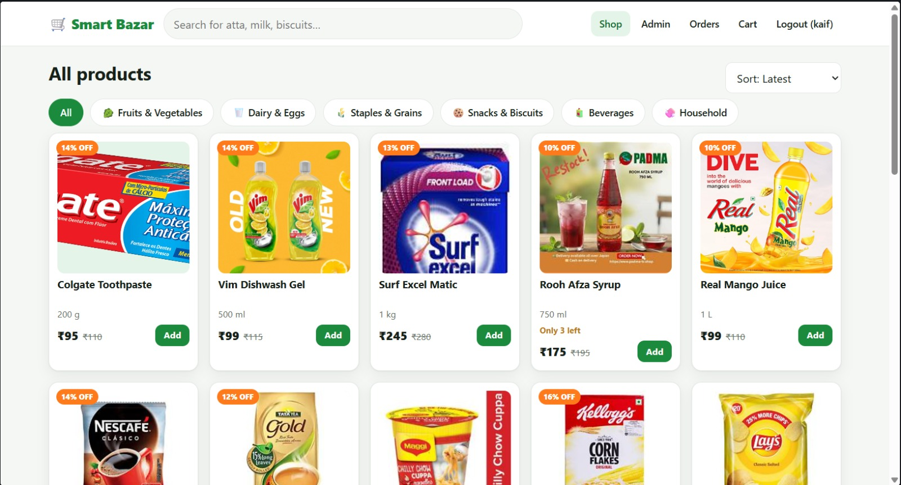

# 🛒 Smart Bazar

A full-stack online supermarket web app with a **customer store** and a **shopkeeper (admin) panel**. Customers browse products, fill a cart and place orders; the shopkeeper manages products (with photos), stock and order status.

> **Live demo:** _add your Render link here_ · **Source:** _add your GitHub repo link here_

## Screenshots

### 1. Shop page



Customers see all 6 categories at the top and a grid of products with real photos. Each card shows the selling price, MRP, discount badge (for example 14% OFF), a low-stock warning ("Only 3 left") and an **Add** button. Customers can search and sort the list.

### 2. Cart


The cart shows the items, quantities and the bill (delivery is free above ₹499). When nothing is added, it shows an empty-cart message with a **Browse products** button.

### 3. My orders


Each customer can see their own orders with the order code, date, items, total amount, payment method (COD or UPI) and a status badge: Confirmed, Out for delivery or Delivered. Opening an order shows the tracking timeline.

### 4. Admin dashboard: overview


The shopkeeper's home screen. It shows paid sales, total orders, orders still to fulfil, number of customers and active products. Below that, the **Low stock** box warns about products running out and the **Top selling** list shows the best sellers with units sold and revenue.

### 5. Admin dashboard: products


The shopkeeper manages the catalog here: product photo, category, price, MRP and stock for all 25 products, with **Edit** and **Delete** buttons. The **+ Add product** button uploads a new product with its photo and **+ Category** adds a category. The Overview and Orders tabs show sales, low-stock alerts and order status updates.

### 6. Project code in VS Code


The project opened in VS Code. The `public` folder holds the frontend (`index.html`, `styles.css`, `app.js`) and the `server` folder holds the backend (`index.js`, `db.js`, `seed.js`) and the SQLite database in `server/data`.

## Features

**Customer**

- Sign up / login (email + password)
- Browse 25+ products across 6 categories, search, sort by price or discount
- Product page, discounts (% off from MRP), "only N left" low-stock hint
- Cart with quantity limits (max 20 per item, never above stock)
- Checkout with delivery address, **Cash on delivery** or **UPI (demo, no real payment)**
- Order history, order tracking timeline (Placed → Confirmed → Packed → Out for delivery → Delivered)
- Cancel an order while it is still Placed or Confirmed (stock is returned)

**Admin / shopkeeper**

- Dashboard: paid sales, total orders, orders to fulfil, customers, low-stock alerts, top-selling products
- Add / edit / delete products with **photo upload** (JPG, PNG, WEBP, max 3 MB)
- Add new categories
- Update order status (cancelling an order returns stock)
- Products that already have orders are hidden instead of deleted, so order history stays correct

**Security and correctness**

- Passwords hashed with bcrypt; login uses JWT tokens (7 days)
- Admin accounts can only be created with a secret `ADMIN_SIGNUP_CODE`, never hardcoded in the code
- Prices and stock are always read from the database on the server, never trusted from the browser
- Order placement runs in a database transaction (no overselling)
- Input validation on every endpoint, rate limiting on login/signup, HTML escaping in the UI

## Tech stack

| Part | Technology |
| --- | --- |
| Backend | Node.js, Express |
| Database | SQLite (`better-sqlite3`) |
| Auth | JWT, bcryptjs |
| Uploads | Multer |
| Frontend | Plain HTML, CSS and JavaScript (no build step) |

## Run locally

1. Install **Node.js 22 LTS** from [nodejs.org](https://nodejs.org) (tick "Add to PATH") and restart your terminal.
2. Clone and install:

   ```bash
   git clone <your-repo-url>
   cd smart-bazar
   npm install
   ```

3. Create your settings file: copy `.env.example` to `.env` and set your own values (see below).
4. Start:

   ```bash
   npm run dev
   ```

5. Open <http://localhost:4000>

The first run creates the database and fills it with sample products.

### Environment variables

| Variable | Required | Description |
| --- | --- | --- |
| `JWT_SECRET` | Yes in production | Long random text used to sign login tokens |
| `ADMIN_SIGNUP_CODE` | Yes in production | Secret code needed to sign up as admin |
| `PORT` | No | Server port (default 4000) |
| `DATA_DIR` | No | Folder for the database and uploaded photos (default `server/data`) |

In development, if you skip `.env`, the defaults are `JWT_SECRET=dev-only-secret` and `ADMIN_SIGNUP_CODE=admin123`. The server refuses to start in production without real values.

### Create your admin account

Open **Sign up → Shopkeeper (Admin)**, enter your details and your `ADMIN_SIGNUP_CODE`. Keep this code private.

## Deploy (Render.com)

1. Push the project to GitHub (`.env` and the database are git-ignored, do not upload them).
2. On Render: **New → Web Service** → pick your repo.
3. Build command `npm install`, start command `npm start`.
4. Add environment variables: `NODE_ENV=production`, `JWT_SECRET`, `ADMIN_SIGNUP_CODE`, and `DATA_DIR=/var/data`.
5. Attach a **persistent disk** mounted at `/var/data`.

> Without a persistent disk (free plan), the database and uploaded photos are reset on every deploy or restart. That is fine for a demo, not for a real shop. A `render.yaml` blueprint is included.

## Business rules

- Delivery fee ₹29, **free above ₹499**
- Max 20 units of one product per order
- UPI is a demo: orders are marked paid without charging money. Replace with a real gateway (for example Razorpay) before real use.
- COD orders become "paid" when the admin marks them Delivered

## API overview

| Method | Endpoint | Access | Purpose |
| --- | --- | --- | --- |
| POST | `/api/auth/signup`, `/api/auth/login` | Public | Create account / login |
| GET | `/api/auth/me` | Logged in | Current user |
| GET | `/api/products`, `/api/products/:id`, `/api/categories` | Public | Catalog |
| POST / PUT / DELETE | `/api/products`, `/api/products/:id` | Admin | Manage products (multipart for photos) |
| POST | `/api/categories` | Admin | Add category |
| POST | `/api/orders` | Customer | Place order |
| GET | `/api/orders`, `/api/orders/:id` | Logged in | Own orders (admin sees all) |
| POST | `/api/orders/:id/cancel` | Customer | Cancel own order |
| PATCH | `/api/orders/:id/status` | Admin | Update order status |
| GET | `/api/admin/stats` | Admin | Dashboard numbers |

## Project structure

```
smart-bazar/
├── server/
│   ├── index.js     # API routes, auth, validation, order logic
│   ├── db.js        # SQLite schema
│   └── seed.js      # sample categories and products
├── public/
│   ├── index.html
│   ├── styles.css
│   └── app.js       # single-page frontend
├── screenshots/     # images used in this README
├── .env.example
├── render.yaml
└── package.json
```

## Possible improvements

- Real payment gateway, order confirmation by email or SMS
- Product reviews, wishlist, delivery time slots
- PostgreSQL and cloud image storage for larger scale
- Automated tests

## License

Personal learning / portfolio project. Add a license of your choice before sharing as open source.
